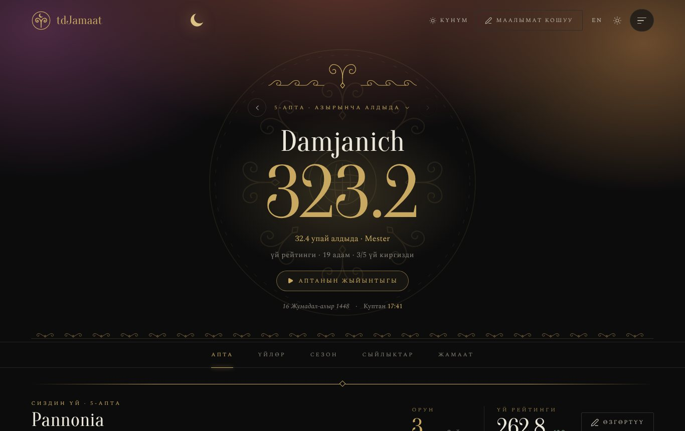
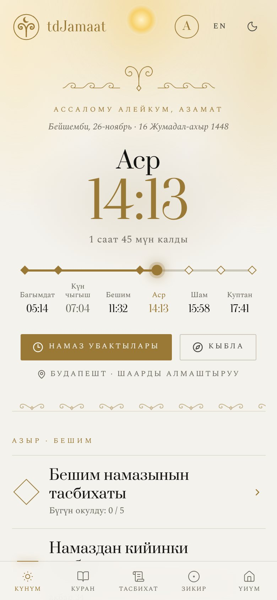
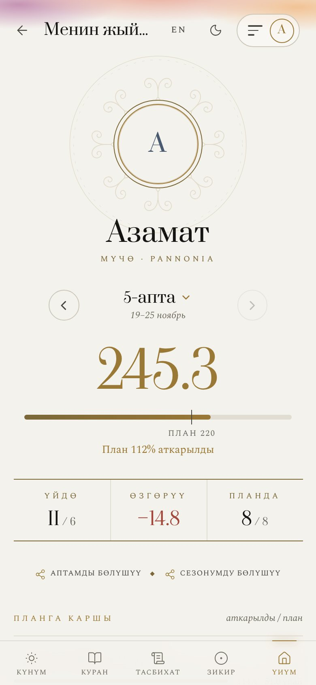
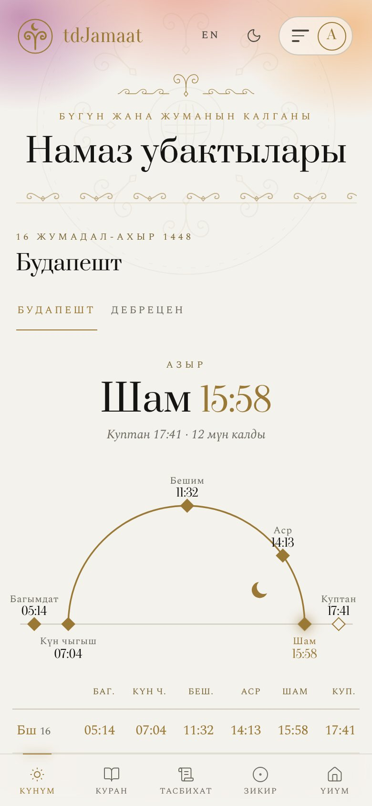
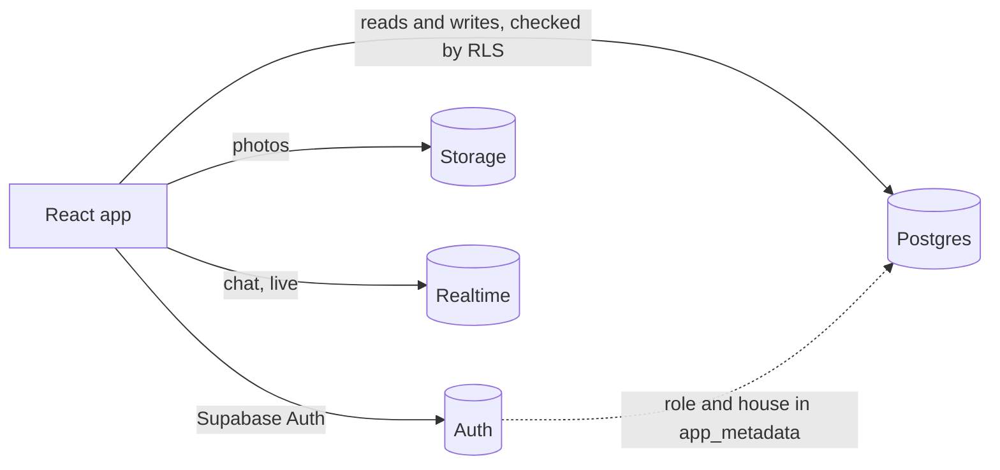

# tdJamaat

[](https://github.com/nurmuhammedkanybekov/tdJamaat-v2/actions/workflows/ci.yml)

A small web app for a Kyrgyz jamaat. Its members live in five shared
houses, and every week each house reports how its people did with Quran
reading, salawat, fasting, night prayer and a few other practices. The app
turns that into a weekly race between the houses, personal results and a
season-long record. It also has the things people open every day: prayer
times, the Quran with a Kyrgyz translation, tasbihat after each prayer, a
zikr counter, the Qibla and an Islamic calendar with a fasting tracker.
Those open without an account, so the site starts on the day itself.
Anyone can sign in with Google to keep their own counts on every device.

The interface is in Kyrgyz, with Russian and English versions.

What the everyday part does:

- **My Day**: the prayer whose time it is, the day's prayer path, today's
  tasbihat, zikr and Quran, the ayah of the day.
- **Quran**: the Madinah mushaf, the Kyrgyz meaning, audio, bookmarks;
  pages count only when the reader marks them, by page range, juz or surah.
- **Tasbihat** after each prayer, with today's five at a glance.
- **Zikr**: a counter, favourites, one's own zikrs, a weekly goal.
- **Calendar**: hijri months, holy days, sunnah fasting days, fasts kept
  (Ramadan, sunnah, nafl, make-up) and a line of plan for any day.
- **Plans**: memorization, Quran reading and books, with due dates and
  history; captains and the admin see who needs attention.
- **Chats**: the house, the captains, the whole jamaat; polls; private
  messages between people who belong together.

<p align="center">
  
</p>
<p align="center">
  
  &nbsp;
  
  &nbsp;
  
</p>
<p align="center"><sub>Screenshots use invented names and numbers.</sub></p>

## Who uses it

| | Signs in with | Sees | Can change |
|---|---|---|---|
| Member | Google | own results, own house, the jamaat totals (other houses without names), chats | own practice counts, own photo |
| Captain | house password | every house's results | own house's weekly numbers, members' Gmail addresses |
| CL (cleanliness) | password | houses and weeks, no results | cleanliness ratings |
| Admin | password | everything | roster, weeks, seasons, plans, chats |
| Personal account | Google (not on the roster) | the everyday pages, its own saved counts | its own counts; can delete itself |
| Visitor | nothing | the everyday pages: prayer times, Quran, tasbihat, zikr, Qibla, calendar | nothing (counts stay on the phone) |

## How it is built

React 19 and TypeScript on Vite, Tailwind CSS v4, Recharts for charts.
There is no backend of its own: the browser talks to Supabase (Postgres,
Auth, Storage, Realtime), and the site is hosted on Vercel.



Access is decided in the database, not in the interface. Every table has
row-level security, and the policies read the user's role and house from
`app_metadata` in the JWT, which only the service key can set. A captain's
password can only ever touch that captain's house. A member is linked to
a person only through the Gmail address the captain saved, so any other
Google account sees nothing. Members get the jamaat-wide numbers through
one `security definer` function that leaves out other houses' names and
photos. Things that must not depend on the client, such as who wrote a
chat message or a person's weekly plan, are set by triggers.

Prayer times are computed on the device with
[adhan](https://github.com/batoulapps/adhan-js), so they work offline.
The app installs to the home screen and caches what it needs.

## Design

The look comes from two places: a printed programme (one serif family,
small letterspaced capitals, gold rules) and the шырдак, the Kyrgyz felt
carpet. Its ram's-horn motif (кочкор мүйүз) is the logo, the border under
every page head and the medallion that turns slowly behind page titles.
Sections open under a gold rule with a diamond instead of sitting in
cards. Each page also gets its own form: prayer times are drawn as the
sun's path over the day, the zikrs hang as beads on a thread, the Quran
page keeps a bookmark with your place in the 604 pages.

My day, the first page, follows the clock. The prayer whose time is
running sits inside a dial, the шырдак medallion behind it and a gold
ring filling as that prayer's time passes, with when it ends. Below come what that hour asks for in three
columns (the prayer's tasbihat, the 33 · 33 · 34, the Quran where you
stopped), the jamaat's latest news under its seal, an ayah of the day
framed like a page of the mushaf, and your week in four numbers.

There are two themes, worked out separately rather than inverted: warm
porcelain by day and black with gold at night, with the sky behind the
header tinted by the hour where you are. Fonts are self-hosted
(Oranienbaum, Prata and Spectral; the Arabic is set in the King Fahd
Complex's Uthmanic Hafs font).

## Scoring

Each person has eight weekly practices, each with a plan that depends on
their role (captain, deputy, member). A practice is worth
`done / plan × weight`, and the weights add up to 220 for a week where
everything is exactly at plan. Going over the plan still counts, with
diminishing returns: past 100% the credited share is
`1 + ln(done / plan)`, so doubling the work adds the same 69% each time
and one practice can't carry a whole week.

A house's rating is the average of its members' scores plus a small team
card (up to 35 points) and, in weeks when it is switched on, a cleanliness
rating (up to 25). Using the average keeps houses of different sizes
comparable. A house that hasn't entered its week yet isn't counted until
the admin locks the week. The formula is in `src/utils/scoring.ts` and is
covered by tests.

## Running it

You need Node 22 and a Supabase project. [SETUP.md](./SETUP.md) walks
through creating the project, running the SQL files in order and creating
the logins.

```bash
cp .env.example .env.local   # add the project URL and the anon key
npm install
npm run dev
```

```bash
npm test         # unit tests (Vitest)
npm run lint
npm run build    # type check and production build
```

CI runs the same three on every push.

## Layout

```
src/
  app/            everyday pages: My day, prayer times, Quran, Tasbihat,
                  Zikr, Qibla, house, chats, help
  components/     results site: week, houses, season, awards, jamaat, forms
  services/       Supabase access, one file per area
  utils/          scoring, rankings, awards, seasons (pure, tested)
  i18n/           Kyrgyz strings in the code, English in en.ts
supabase/         schema and migrations, run in the order given in SETUP.md
scripts/          creating logins, turning a backup into SQL
api/keepalive.js  daily ping so the free Supabase project isn't paused
public/quran/     Quran text and translation, one file per surah
```

## Sources

- Quran text: the Madinah mushaf (Hafs), King Fahd Complex.
- Kyrgyz meaning: Shamsuddin Hakimov, via [QuranEnc](https://quranenc.com).
- Recitations: [everyayah.com](https://everyayah.com).
- Tasbihat text: [Санарип тасбихат](https://addua.vercel.app), used unchanged.

## Credits

The idea and the original scoring formula come from the first tdJamaat,
built by Muslim ([@Muslim04](https://github.com/Muslim04)). This is a
rewrite on a new stack with a proper data model, per-house logins, seasons
and a new design. The formula underneath is his.

## Security

Keys and passwords never go into the repository. `.env`, `.env.admin` and
`scripts/syr_sozdor.json` are ignored by git; copy the `*.example` files
and fill them in locally. If you find a security problem, please write to
the maintainer privately instead of opening a public issue.
