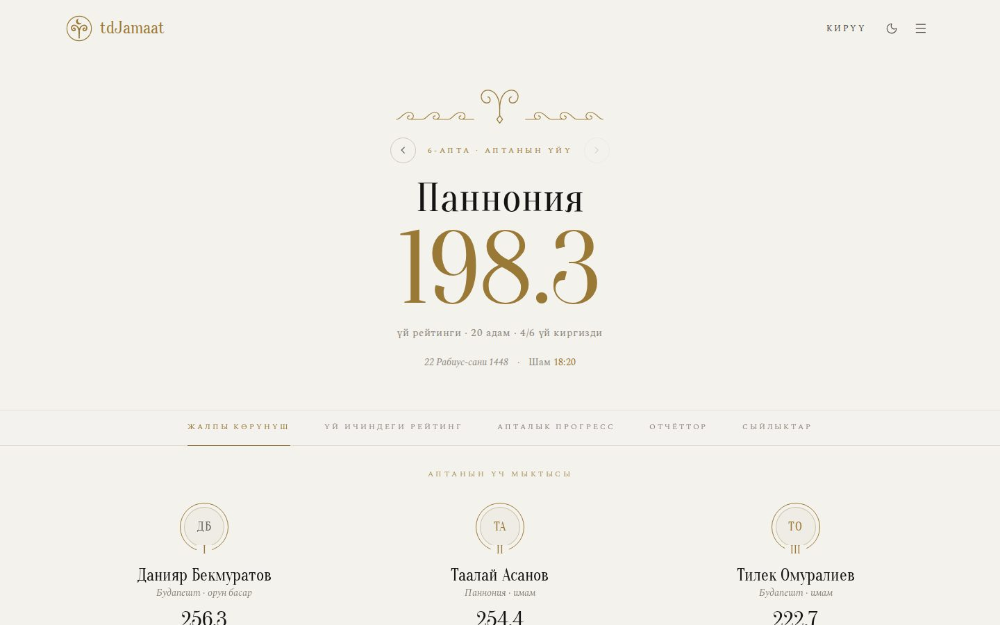
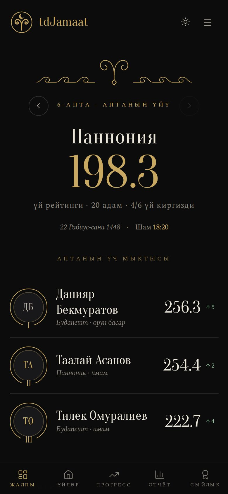
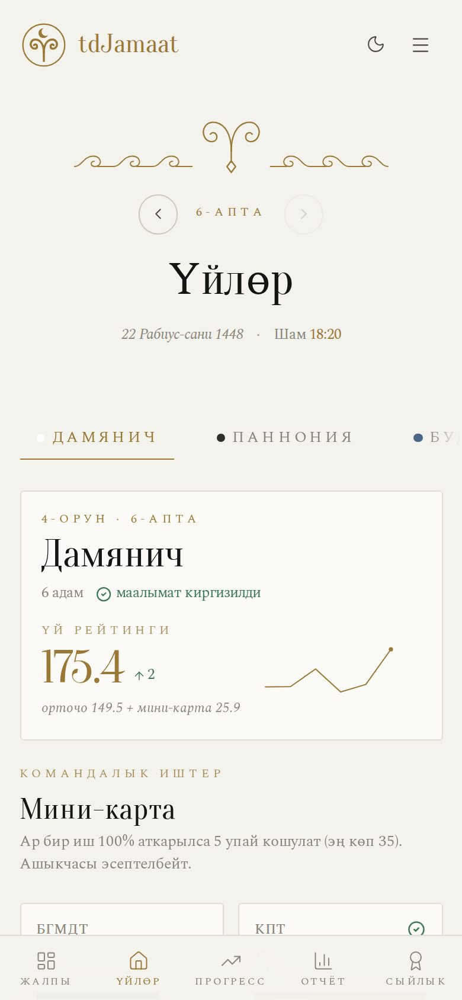
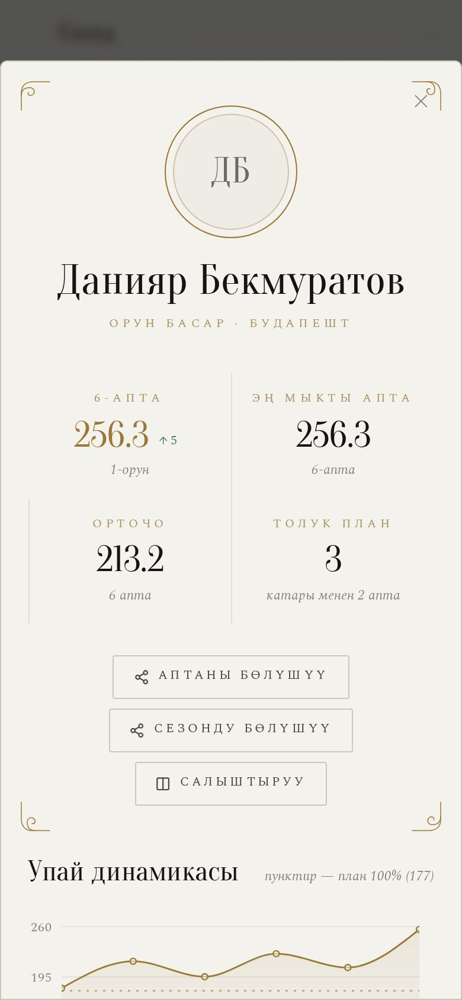
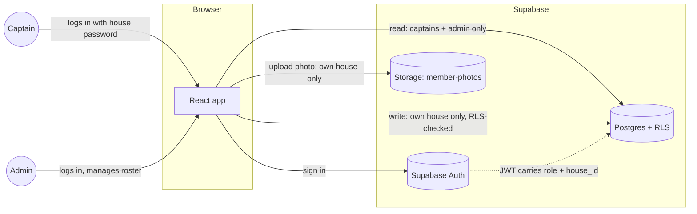
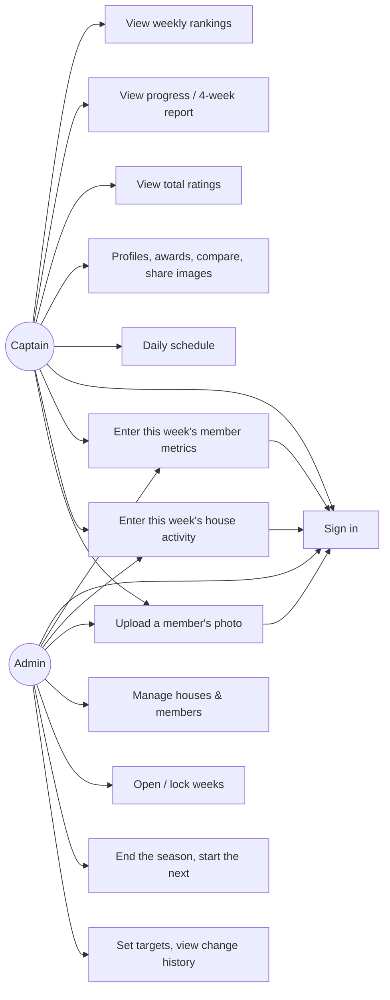
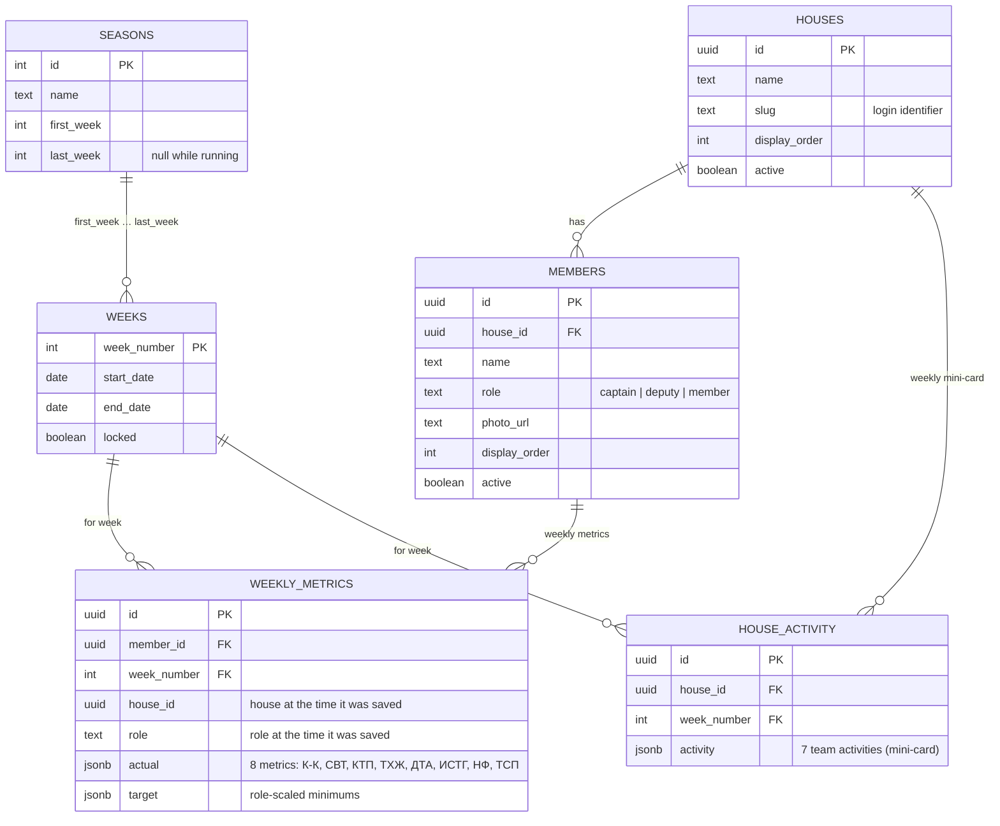

# tdJamaat


[](https://github.com/nurmuhammedkanybekov/tdJamaat-v2/actions/workflows/ci.yml)

**Live: [tdjamaat.vercel.app](https://tdjamaat.vercel.app)**

A weekly performance dashboard for a community organized into small teams
("houses"). Each house's captain logs every member's results against a set
of personal metrics, plus a few team activities, once a week; the app turns
that into scores, rankings, awards and trend charts the whole community can
see. The interface is in Kyrgyz, with an English version.

Rebuilt from the original [tdJamaat](https://github.com/Muslim04/tdJamaat)
as an independent project on a normalized data model — real houses and
members instead of a JSON blob re-typed every week — with per-house
authenticated logins instead of one shared password, seasons, and a full
visual redesign.

<p align="center">
  
</p>
<p align="center">
  
  &nbsp;
  
  &nbsp;
  
</p>
<p align="center"><sub>Light theme, invented demo data. The site also has a black-and-gold dark theme.</sub></p>

## Contents

- [Features](#features)
- [Design](#design)
- [Stack](#stack)
- [Architecture](#architecture)
- [Data model](#data-model)
- [Scoring](#scoring)
- [Getting started](#getting-started)
- [Project structure](#project-structure)
- [Branches](#branches)
- [Access & security](#access--security)
- [Credits](#credits)

## Features

- **Made for every screen.** On a phone the open pages are single
  columns with a back arrow; on a computer they are a site: section links
  in the header, the front page in two columns, lists in grids, the
  tasbihat with a table of contents beside the text.
- **The day as a dial.** The front page draws the day as a 24-hour ring
  shaped like a түндүк: the six prayer times set around it, the sun or
  moon standing at the present moment, the next prayer in the middle.
- **The captains' entrance is in plain sight**: a «Кирүү» button in the
  header and a card on the front page. A device that has logged in before
  opens straight on the login screen, as it always did.
- **An open front door (no login).** Today's prayer times, the Quran, the
  tasbihat and a zikr counter are for anyone who opens the site:
  - *Quran* — the Arabic text of the Madinah mushaf (Hafs), as published
    by the King Fahd Complex, in the Complex's own typeface: 114 surahs
    with search, page marks, adjustable text size, and "continue where I
    stopped". A surah opened once can be read offline.
    See [`public/quran/README.md`](public/quran/README.md) for the source.
  - *Tasbihat* — what is read after each of the five prayers, taken
    unchanged from the community's «Санарип таспихат»
    ([addua.vercel.app](https://addua.vercel.app)): the prayer whose time
    it is now is offered first; directions are set apart from the words;
    every line that is read several times is its own tap counter; the
    meaning opens under the paragraph; the text size is adjustable and the
    screen stays on while reading. See
    [`src/public/tasbihat/README.md`](src/public/tasbihat/README.md).
  - *Zikr* — ten zikrs (tasbih, tahmid, takbir, tahlil, istighfar,
    salawat…) and the 33·33·34 tasbih after prayer. The whole screen is
    the button; a ring fills to the chosen target (33, 99, 100, 1000 or
    no limit) with a gentle vibration on completion. Today's total, the
    last seven days and the all-time count are kept **on the device
    only** — nothing is sent anywhere, and it has no part in the scores.
- **The results are private: captains and the admin only.** No result is
  shown before logging in. Each house's captain has one password, sees the results and
  can only write that house's own weeks; a separate admin login manages
  the roster and can edit anything. Enforced by Postgres row-level
  security (roles live in `app_metadata`, which users can't change), not
  just hidden in the UI. The site also asks search engines not to index it.
- **A desk for whoever logs in.** A captain's overview opens on their own
  house's week: place and rating (with the change since last week), the
  points to the house above, how many people met the full plan, and where
  the house lost the most points and who was below plan there — with one
  button to enter (or correct) that week. The admin sees which houses are
  still missing, with a button to enter for any of them.
- **Roster changes mid-season.** Moving someone to another house or
  giving them a new role starts from a chosen week; earlier weeks stay
  where they were earned, a new captain starts from the captain plans,
  and the data-entry form for any week shows who was actually in the
  house that week.
- **Role-scaled targets.** A captain (капитан), a deputy (орун басар), and a regular member
  have different expected minimums for each metric — the app seeds new
  weekly entries with the right target for that person's role instead of
  one flat number for everyone.
- **Five tabs, from the nearest to the widest view**: *Week* (your house,
  the week's podium, the house and people tables), *Houses* (one house:
  members as a heat table, team activities, where the points came from),
  *Season* (season tables, the rating week by week, the race for places,
  four-week reports), *Awards*, and *Community*. Each fact lives in one
  place; old links to #/progress and #/reports open the Season tab.
- **Personal profile pages.** Tap anyone to see their score trend, how
  close they are to each target this week, best week, perfect-week streak,
  badges and full week-by-week history.
- **Where the points came from.** Each profile splits the score by metric
  (points earned / points for 100% of the plan), for the selected week or
  as the season average, and names the strongest metric and the one
  furthest from its plan. The house page has the same view for the house
  (average per person, how many met each plan, who is still below it).
- **Goal hints in the data-entry form**: under each person, what is still
  missing to reach the plan and how many points it would add
  ("К-К +3 (+19.3)"), updated while typing.
- **Overview filters**: this week or the whole season so far (average over
  the counted weeks; people need at least half of the weeks for a place),
  and next to the house rating: all cities or one city (which house belongs
  to which city is set in `src/utils/standings.ts`).
- **Compare** also says how many of the 8 metrics each side leads.
- **Community images**: the whole community's totals for the week or for
  the season as a shareable picture (from the share window or the
  community tab).
- **Awards.** Strava-style badges for people and houses (star of the week,
  perfect plan, streaks, biggest leap, house of the month, …), each earned
  automatically from the real numbers and shown with the exact reason.
- **Shareable results card.** A ready-made image of the week's rankings to
  send to WhatsApp/Telegram groups (drawn in the browser, no server).
- **Submission status.** Signed-in captains and the admin see which houses
  have entered this week's numbers.
- **Change history and week locking.** Every save is recorded (who, when,
  before → after); the admin can lock a finished week so it can no longer
  be edited by captains. Both enforced in Postgres.
- **Seasons.** Results are kept per season with a full archive of past
  seasons. The admin ends a season with one button; the next one starts at
  week 1, and people can move to new houses without last season's results
  moving with them.
- **Compare.** Put two people or two houses side by side: this week,
  season average and place, best week, perfect weeks, medals, who won more
  weeks head to head, per-metric percentages and a two-line trend chart.
- **Season summary ("Wrapped").** Each profile shows the person's season
  so far, and both the week and the season can be shared as an image, in a
  dark or a light version.
- **Daily schedule.** The header shows the date and the next time on the
  community's daily schedule; a schedule page (per city, computed on the
  device, works offline) lists today and the next 7 days.
- **Community section.** What the whole community did together this
  season — every metric and team activity summed up — this week compared
  with last week (only houses that entered both weeks), season records,
  and a Hall of Fame for every season.
- **Excused weeks.** A captain can mark someone as excused for a week
  (sick, travelling): they are left out of the house average and the
  ranking, and the week neither breaks nor extends their streaks.
- **Typo warnings.** A number that is 10× the plan and 3× what the person
  usually enters asks "are you sure?" before saving.
- **"Чоң экран" (big screen) mode** for meetings on a monitor or projector:
  larger, heavier type, stronger contrast, thicker chart lines
  (menu, or `?ekran` in the address).
- **Kyrgyz or English.** Kyrgyz is the default; the "EN" / "КЫР" button in
  the header switches the whole site (metric codes get English labels too)
  and each device remembers its choice. People's names and the stored data
  stay as they are. House names are always shown in Latin letters, in both
  languages (a name stored in Cyrillic is transliterated).
- **Admin panel**: open/lock weeks, end the season, edit the roster
  (names, roles, houses), edit season targets, download a backup.
- **Installable app (PWA)** with a home-screen icon; refreshes live every
  couple of minutes while open, and offers a "new version" button after a
  deploy (never reloads by itself, so nothing being typed is lost). If the
  connection drops, the numbers stay on screen with a note saying when
  they were last loaded, and refresh by themselves once it is back. The
  app opens instantly on the last results the device loaded (kept per
  login, removed on logout) and refreshes them in the background.
- **A sky that follows the prayer times.** The header is tinted by the time
  of day in the chosen city (dawn after Fajr, noon, afternoon after Asr,
  sunset after Maghrib, night after Isha); on the Week tab the sun, or the
  moon at night, crosses its arc. A ram's-horn (кочкор мүйүз) border
  closes the header (src/utils/sky.ts).
- **"Аптанын жыйынтыгы" — the week as a story.** A full-screen, animated
  recap (house of the week, the race between houses, the top three, the
  biggest jump, what the community did together), for meetings and for
  sharing; tap or ← / → to move, it moves on by itself.
- **Keyboard shortcuts** for the laptop in meetings: ← / → change the week,
  1–6 switch sections.
- **Adapts to any screen**: phones get a bottom tab bar and card layouts,
  and the whole interface scales smoothly from a phone to a projector.
- **Self-service member photos**, uploaded by a house's own captain
  straight from the data-entry screen.
- **Light and dark themes**, both built from the same validated color
  tokens so role and team colors stay distinguishable (including for
  colorblind readers) in either mode.

## Design

"Түн" (night): black and gold, one metal, a lot of air, with a light "Күн"
(day) theme. Kyrgyz ornament — түндүк, тумар, ram's horn (кочкор мүйүз) —
is drawn as single gold hairlines rather than filled patterns, and the
award medals are drawn as struck coins with a reeded edge. Type, self-hosted
so the app also works offline: Oranienbaum for numbers and Latin letters,
Prata for Cyrillic headings and names (every Kyrgyz letter — Ң, Ө, Ү — in one
typeface), Spectral for text.

## Stack

| Layer | Choice |
|---|---|
| Frontend | React 19, TypeScript, Vite (rolldown), Tailwind CSS v4 |
| Charts | Recharts |
| Icons | Lucide React |
| Daily schedule | [adhan](https://github.com/batoulapps/adhan-js) (computed on the device) |
| Tests | Vitest |
| Database & auth | Supabase (Postgres, Row Level Security, Supabase Auth, Storage) |
| Hosting | Vercel |

No custom backend server — the frontend talks to Supabase directly, and
RLS policies are what actually enforce who can write what.

## Architecture



RLS policies read `role` and `house_id` straight out of the signed-in
user's JWT (`supabase/schema.sql`), so a leaked house password can only
ever affect that one house's scores — the database enforces it even if
the frontend had a bug.

### Use cases



## Data model



Houses and members are persistent rows, entered once — a new week just
adds `weekly_metrics`/`house_activity` rows against the existing roster,
instead of re-typing the whole team into a fresh JSON blob every time (how
the original app worked).

Also in the database: `season_settings` (the role minimums and mini-card
targets — the source of truth for targets) and `audit_log` (every change:
who, when, before → after). Week numbers keep counting across seasons in
the database; the site shows them per season (each season starts at
"1-апта"). Because every saved row remembers the house it was earned in,
people can change houses between seasons without moving old results.

## Scoring

Each of the 8 individual metrics (К-К, СВТ, КТП, ТХЖ, ДТА, ИСТГ, НФ, ТСП)
is scored as `(actual / target) × weight` and summed into a member's
score. A metric with no target set gives 0, never a free 100%. Weights:
К-К 45, СВТ 10, КТП 30, ТХЖ 30, ДТА 50, ИСТГ 10, НФ 20, ТСП 25 (exactly 100%
on everything = 220).

Going over the plan still earns more, with diminishing returns: up to 100%
the percentage counts as it is; above it, the credited percentage is
`100% × (1 + ln(done ÷ 100%))`. Every doubling of the work adds the same
+69% of plan — 200% counts as 169%, 400% as 239%, 800% as 308% — so one
metric done many times over can't carry a whole week.
The weights are the same for everyone; what changes by role is the
**target** each metric is measured against:

| | К-К | СВТ | КТП | ТХЖ | ДТА | ИСТГ | НФ | ТСП |
|---|---|---|---|---|---|---|---|---|
| Капитан | 20 | 2100 | 70 | 2 | 1 | 700 | 7 | 10 |
| Орун басар | 10 | 1400 | 40 | 1 | 1 | 350 | 7 | 7 |
| Мүчө | 7 | 700 | 30 | 1 | 1 | 200 | 7 | 7 |

**House rating** = the average member score + the mini-card bonus. The
mini-card has 7 team activities (БГМДТ, КПТ, И-Н.2, КИТЕП, СПОРТ, ТСПХ,
БАБХ; target 7 each, except КИТЕП 5 and СПОРТ 1). Each activity gives up
to 5 points, capped at 100%, so the bonus is at most 35. The average (not
the total) keeps houses of different sizes comparable.

A week a house hasn't submitted shows "—" and isn't counted anywhere
(rankings, averages, trends, reports) while the week is open, so a house
that is simply late doesn't look like it collapsed. Once the admin locks
the week, a house that still hasn't submitted counts as 0 for it
(`weekCounts` in `src/utils/insights.ts`).

Targets are enforced in the database: a person's target carries forward
from their previous week within the season, or starts from the role
minimum. Only the admin can change a target; a value a captain sends
is replaced by a trigger (`supabase/season-2026-09.sql`,
`supabase/seasons-2026-10.sql`). The formula lives in
`src/utils/scoring.ts` and is covered by tests.

## Getting started

New Supabase project, schema, roster, and login accounts — see
**[SETUP.md](./SETUP.md)** for the full walkthrough. Once that's done:

```bash
npm install
npm run dev
```

```bash
npm run build   # type-check + production build
npm run lint    # eslint
npm test        # vitest: scoring, rankings, awards, seasons, compare, schedule
```

Every push and pull request runs the same three checks on GitHub Actions
(`.github/workflows/ci.yml`).

## Project structure

```
src/
  TeamPerformanceTracker.tsx   app shell: puts the hooks, views and modals together
  public/              the pages open without login: Portal (front door), QuranPage,
                       TasbihatPage (+ tasbihat/ texts), ZikrPage, their frame and hash
                       routes (#/quran, #/tasbihat, #/zikr, #/namaz, #/login)
  components/          shared UI (AppHeader, ProfileSheet, CompareSheet, ShareSheet,
                       AdminPanel, AdminSeason, HistorySheet, DataEntryForm,
                       BadgeMedal, Ornament, ui.tsx, …)
  components/views/    one component per tab (Overview = Week, Teams, Season, Awards, Community);
                       Standings.tsx holds the house/people tables shared by Week and Season
  services/            Supabase reads/writes (dataService.ts, buildDataFile.ts) and auth
  utils/               scoring formula, season insights, the captain/admin desk, badges,
                       seasons, compare, data-entry drafts, share-card drawing,
                       calendar and daily schedule
  i18n/                Kyrgyz/English: t() and the English texts (en.ts), keyed by
                       the Kyrgyz text; a test checks every t() text has a translation
  hooks/               useAuthUser (who is logged in), useResults (loading, live refresh,
                       offline/stale state), useHashRoute (#/<view>?m=<member>),
                       useThemeState, useKeyboardNav, useModal (scroll lock + Escape),
                       useMediaQuery, useNow
  test/                test data builders
  lazyLoad.ts          on-demand code: the charts and the sheets load after the first
                       screen (prefetched right away), and a page left open across a
                       deploy reloads itself instead of failing
  pwa.ts               service worker registration + install prompt
  types/               shared TypeScript types
supabase/              run in the SQL editor, in the order listed in SETUP.md
  schema.sql           tables + row-level security policies
  seed.sql             houses/members roster
  photo-upload-setup.sql   storage bucket + photo-upload policies
  season-2026-09.sql   season targets + database-enforced season rules
  add-babh-2026-09.sql, kitep-target-5-2026-10.sql   mid-season target changes
  history-and-locks-2026-10.sql   change history + admin week locking
  seasons-2026-10.sql  seasons, per-week house snapshot, end-of-season function
  excused-weeks-2026-10.sql   excused weeks (weekly_metrics.excused)
  roster-changes-2026-11.sql  mid-season moves / new roles; a saved week belongs to its house
  private-site-2026-11.sql    results readable by captains/admin only; roles from app_metadata
  private-photos-2026-11.sql  member photos readable by captains/admin only (signed links)
  protect-history-2026-11.sql no cascading deletes of results; entered numbers checked
  update-2026-09-names.sql   one-time fixup, already applied — don't re-run
api/keepalive.js       daily Vercel cron so the free Supabase project never pauses
public/
  favicon.svg, icons/  app mark (a ram's horn in a ring)
  manifest.webmanifest, sw.js   installable app (never caches the data)
docs/                  README screenshots
scripts/
  backup-to-sql.js     turns a downloaded backup into SQL for an empty database (restore)
  create-auth-users.js provisions the captain (per house) and admin login accounts
  syr_sozdor.example.json  template for the (gitignored) real passwords file
```

## Branches

- `master` — what runs on [tdjamaat.vercel.app](https://tdjamaat.vercel.app).
- `nurmss` — day-to-day work; merged into `master` when it's ready.
- `nurmss-<topic>` — experiments waiting for a decision (e.g.
  `nurmss-next`: the open Quran / zikr pages and the safety work). They
  are merged only once approved.

## Access & security

- Four pages are open to everyone: prayer times, the Quran, the tasbihat
  and the zikr counter. They read no data from the database.
- The results are **private**: none can be seen without logging in, and the
  database itself returns nothing to a visitor (only house names, for the
  login screen, and week numbers). It is also not indexed by search
  engines (noindex meta, robots.txt and an `X-Robots-Tag` header).
- Each **house** has its own password, for its **captain** only, and can
  only write that house's own weekly data (a saved week belongs to the
  house it was earned in, even after someone moves).
- The **admin** password can do everything, including managing the
  houses/members roster and opening new weeks.
- Both are enforced by Postgres row-level security, which reads each
  account's role from `app_metadata` (only the server key can set it), not
  just hidden in the interface.
- Real credentials never live in this repo: `.env`, `.env.admin`, and
  `scripts/syr_sozdor.json` are all gitignored — copy the matching
  `*.example` file and fill in real values locally.

## Credits

The original tdJamaat — the idea, the 8-metric scoring formula, and the
first working version the community actually used — was designed and
built by **Muslim** ([@Muslim04](https://github.com/Muslim04)), who
maintained it until stepping back. This repository is a from-scratch
second version: a new stack, a normalized data model, and a full visual
redesign, but the formula and the concept underneath it are his.
