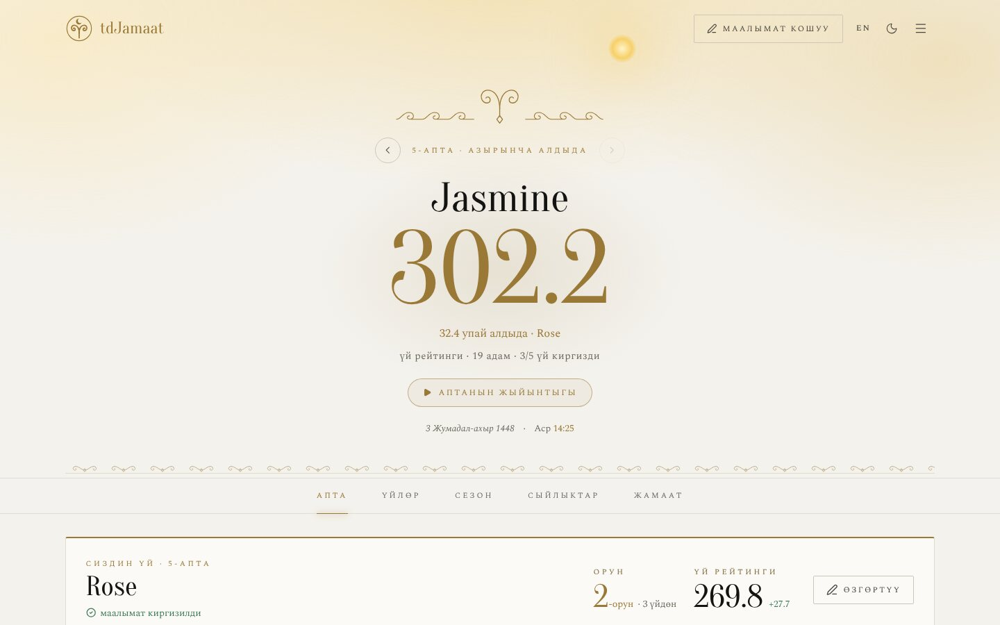
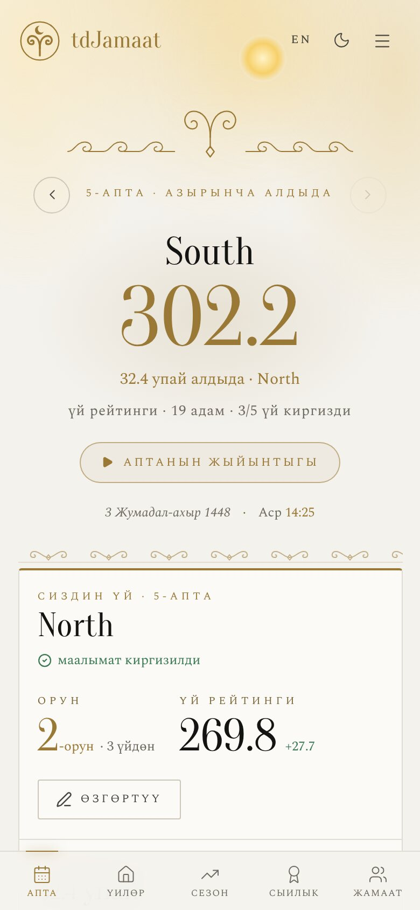
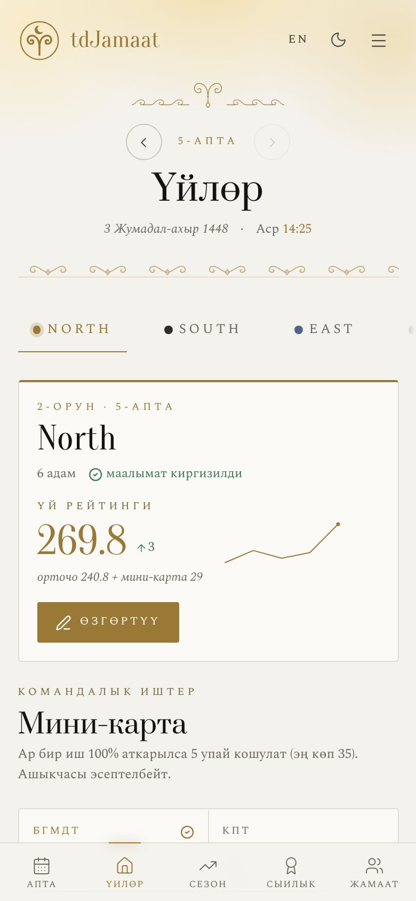
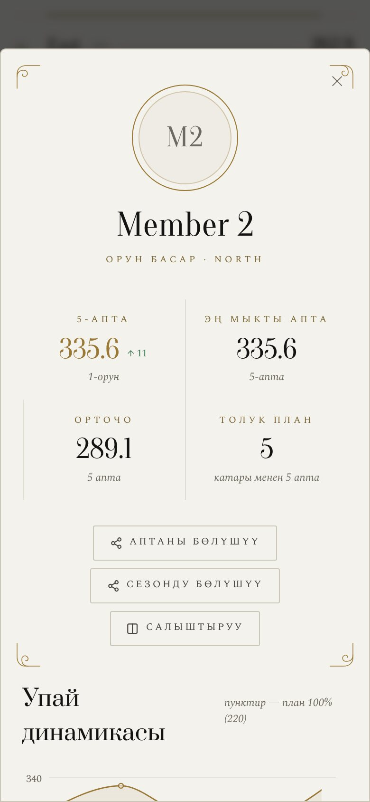

# 0. Read this first

**What this is.** tdJamaat is a private website for a community that is split
into small teams ("houses"). Once a week each team's captain enters what every
member did that week — pages of Quran read, nights of tahajjud, fasting days,
and so on. The website turns those numbers into scores, rankings, awards and
charts that the captains and the admin can see, and into pictures that can be
shared in a WhatsApp or Telegram group.

**The short version.**

- It is a normal website. There is nothing to install for the people who use
  it; they open a link on their phone or laptop and log in.
- It is **private**. Nobody can see any results without logging in — the
  database itself refuses to show them, not only the screen.
- It costs **nothing to run** for a community of this size (free plans of
  Supabase and Vercel — see section 5).
- Setting it up is a one-time job for **one person comfortable with a
  computer**. After that, the weekly routine needs no technical skill.
- The *rules* of the competition (what is counted, how many points each thing
  is worth, who gets which target) are the community's own. The website can
  carry yours; some changes are a settings screen, some are a text edit, and
  some need a developer. Section 4 and section 8 say exactly which is which.

**Honest effort table.** These are estimates, not promises.

| What you want | Who can do it | Rough time |
|---|---|---|
| Just look around | anyone | 10 minutes (screenshots below) |
| The same system with **your** houses, members, passwords and targets | someone who can follow written steps and copy–paste | 2–4 hours the first time |
| Also **rename** the things you count, translate the texts, change colours and name | the same person, editing a few text files | 1–2 days |
| **Different** things to count (more or fewer than 8 personal and 7 team items), a different scoring formula, different roles | a web developer (React + TypeScript) | several days |

---

# 1. What the website does

<p align="center">

</p>
<p align="center">
 &nbsp;
 &nbsp;

</p>

*(Invented demo data, light theme, Kyrgyz interface — an English version and a black-and-gold dark theme are built in.)*

## 1.1 The people who use it

| Person | What they do | What they can see | What they can change |
|---|---|---|---|
| **Admin** (one or two people) | Opens each new week, sets targets, manages houses and members, ends the season, takes backups | Everything | Everything |
| **Captain** (one per house) | Once a week, enters the results of the members of **their own house** | The results of **all** houses and people | Only their own house's numbers (the database enforces this) |
| **Everyone else** | — | Nothing. They have no login. | — |

Each house has **one password**, shared by whoever is its captain. The admin
has a separate password. There are no individual accounts and no email
addresses to collect.

Inside a house, every member has a **role** — *captain*, *deputy* or *member*
— and the role decides how high their targets are (a captain is expected to
do more than a new member). The roles are labels for the targets; they do not
give anyone extra access on the website.

## 1.2 The screens

The site has five sections, from the closest view to the widest:

| Section | Kyrgyz name | What is on it |
|---|---|---|
| **Week** | Апта | Your house first (place, rating, change since last week, what is missing to reach the plan), the "house of the week", the top three people, tables of all houses and all people |
| **Houses** | Үйлөр | One house at a time: every member as a heat-table of the week, the team activities, and *where the points came from* |
| **Season** | Сезон | Season tables, the rating week by week, the race for places, four-week reports |
| **Awards** | Сыйлыктар | About 18 badges (star of the week, perfect plan, streaks, biggest leap, house of the month…), each earned automatically and shown with the exact reason |
| **Community** | Жамаат | What the whole community did together: every item added up, this week against last week, season records, a hall of fame |

Other things you will meet:

- **Profile page** for every person: score trend, how close they are to each
  target, best week, streaks, badges, a week-by-week history, and a
  "season summary".
- **Compare** two people or two houses side by side.
- **Shareable pictures** — the week's results, or a person's season, drawn as
  an image (dark or light) to send to a group chat. Drawn in the browser; no
  server involved.
- **"Week as a story"** — a full-screen animated recap for the weekly meeting.
- **Big-screen mode** — larger type and stronger contrast for a projector.
- **Goal hints** in the entry form: under each person it says what is still
  missing to reach the plan and how many points it would add, updating as you
  type.
- **Typo warning**: a number ten times the plan and three times what the
  person normally enters asks "are you sure?" before saving.
- **Excused weeks**: a captain can mark someone as excused (ill, travelling).
  They are left out of the average and the ranking for that week, and their streak
  is neither broken nor extended.
- **Seasons**: the admin ends a season with one button; results are archived
  and the next season starts again at week 1.
- **Change history and locking**: every save is recorded (who, when, before →
  after), and the admin can lock a finished week.
- **Installable on a phone** like an app (home-screen icon), refreshes by
  itself every couple of minutes, keeps showing the last numbers if the
  connection drops.
- **Two languages** (Kyrgyz and English), light and dark themes.
- **Prayer-time features** — a header that follows the time of day, and a
  prayer-times page for the chosen city, calculated on the device. (These are
  optional extras; see section 8.)

## 1.3 What it deliberately does **not** do

- It does not let members log in or enter their own numbers. The captain
  enters them (that is the design: one trusted person per house).
- It does not send notifications or emails.
- It does not make anything public. There is no public leaderboard.

---

# 2. How a week works

1. **Admin opens the week.** Menu → **Админ панели** → **Апталар** →
   **Жаңы апта ачуу**. Captains can only fill in weeks that exist, so nothing
   can be entered by mistake in a future week.
2. **During the week**, members do their things and tell their captain what
   they did, in whatever way the community already uses.
3. **Captain enters the results.** The captain logs in, taps **Маалымат кошуу**, and
   the form opens on the latest week. For each member of the house they type
   what was done (**Факт**) next to the plan (**План**, locked — only the
   admin changes plans). The form shows live what is still missing for each
   person. They also fill in the house's team activities (the "mini-card").
   They tap **Сактоо**. They can come back and correct it any time until the
   admin locks the week.
4. **Everyone sees the result** as soon as it is saved. The Week tab shows
   which houses have already entered. A house that has not entered yet shows
   "—" and is **not** counted as zero while the week is open, so a house that
   is simply late does not look like it collapsed.
5. **Meeting.** The community looks at the Week tab or the "week as a story" on
   a screen, and the results image goes to the group chat.
6. **Admin locks the finished week** (optional) and opens the next one.
7. **Once a week, the admin downloads a backup**: **Админ панели** →
   **Камдык көчүрмө**. It is a single file with the whole database.
8. **At the end of a season**, the admin ends it, names the next one, moves
   people to their new houses, and opens week 1.

---

# 3. How the scoring works

You do not have to keep the original scoring. But you should understand it, because it
is the part most communities want to adjust.

## 3.1 One person's score

The website measures eight personal items. Each has a **plan** (the minimum
expected that week, which depends on the person's role) and a **weight** (the
points earned at exactly 100% of the plan).

1. **Percentage of plan** = done ÷ plan × 100.
   If an item has no plan (0), it earns 0 — never a free 100%.
2. **Credited percentage.** Up to 100%, the percentage counts as it is. Above
   100% it still earns more, but with *diminishing returns*:
   `credited = 100% × (1 + ln(done ÷ plan))`.
   Every doubling of the work adds the same +69% of plan:

   | Done | 100% | 200% | 400% | 800% | 1600% |
   |---|---|---|---|---|---|
   | Counted as | 100% | 169% | 239% | 308% | 377% |

   This is so that one thing done many times over (for example a counter
   that is quick to multiply) cannot carry a whole week.
3. **Points for the item** = credited percentage ÷ 100 × weight.
4. **Score of the person** = the sum over all eight items. Doing exactly 100%
   of everything gives **220** points with the original weights.

The original eight items, with their weights and the units they are counted in:

| Code | Meaning | Weight | Plan: captain / deputy / member |
|---|---|---|---|
| К-К | Quran reading (pages) | 45 | 20 / 10 / 7 |
| СВТ | Salawat (count) | 10 | 2100 / 1400 / 700 |
| КТП | Book reading (pages) | 30 | 70 / 40 / 30 |
| ТХЖ | Tahajjud prayer (nights) | 30 | 2 / 1 / 1 |
| ДТА | Voluntary fasting (days) | 50 | 1 / 1 / 1 |
| ИСТГ | Istighfar and dhikr (count) | 10 | 700 / 350 / 200 |
| НФ | Nafl prayers (days) | 20 | 7 / 7 / 7 |
| ТСП | Tasbihat (days) | 25 | 10 / 7 / 7 |

*(Weights are the same for everyone; what changes with the role is the plan.
The units in the second column are only an example — your community decides
its own.)*

**A worked example.** A regular member, plans as in the table (К-К 7, СВТ 700,
КТП 30, ТХЖ 1, ДТА 1, ИСТГ 200, НФ 7, ТСП 7). In one week they read 7 pages,
said 1400 salawat, read 15 pages of a book, prayed tahajjud once, did not fast,
and did the rest exactly to plan:

| Item | Done / plan | Percent | Counted | × weight | Points |
|---|---|---|---|---|---|
| К-К | 7 / 7 | 100% | 100% | 45 | 45.0 |
| СВТ | 1400 / 700 | 200% | 169.3% | 10 | 16.9 |
| КТП | 15 / 30 | 50% | 50% | 30 | 15.0 |
| ТХЖ | 1 / 1 | 100% | 100% | 30 | 30.0 |
| ДТА | 0 / 1 | 0% | 0% | 50 | 0.0 |
| ИСТГ | 200 / 200 | 100% | 100% | 10 | 10.0 |
| НФ | 7 / 7 | 100% | 100% | 20 | 20.0 |
| ТСП | 7 / 7 | 100% | 100% | 25 | 25.0 |
| | | | | **Score** | **161.9** |

## 3.2 A house's rating

**House rating = the average score of its members + the team-activities
bonus.**

- It is the **average**, not the total, so a house of five can compete fairly
  with a house of eight.
- Members marked *excused* that week are left out of the average.
- The **team activities** ("mini-card") are seven things the house does
  together (for example, a shared prayer, a group book, sport). Each one earns
  up to **5 points** at 100% of its target, and never more than that — a house
  cannot "overdo" one. The bonus is therefore at most 35.

Example, the same week: two members scored 161.9 and 172.1 → average **167.0**.
The house did its seven activities as 7/7, 5/7, 7/7, 6/5, 0/1, 7/7, 7/7 → the
points are 5 + 3.6 + 5 + 5 (capped) + 0 + 5 + 5 = **28.6**. House rating:
167.0 + 28.6 = **195.6**.

## 3.3 A week a house has not entered

While the week is open, such a house shows "—" and is left out of every
ranking and average. Once the admin **locks** the week, a house that never
entered counts as **0** for it.

## 3.4 Who sets the plans

Plans (targets) are set **by the admin only**, per role, in the website
(**Админ панели → Пландар**). A person's plan carries forward from their previous
week within a season, so the admin can give one person a custom plan (for
example during an illness) by changing it for that week. A captain cannot
change a plan — and this is enforced by the database, not just hidden on the
screen, so a captain cannot lower their own house's plans to improve their
percentages.

Past weeks keep the plan they were saved with; changing a plan later never
rewrites history.

---

# 4. Decide first: what will be different in your version

Before anyone touches a computer, the community should agree on this
worksheet. It takes one meeting. Everything later follows from it.

| # | Question | In the original | Where this is changed |
|---|---|---|---|
| 1 | **Name** of the website | tdJamaat | Text files (section 8.1) |
| 2 | How many **houses** (teams), and their names | a handful of named houses | Seed file / admin screen |
| 3 | The **members** of each house and who is **captain / deputy** | 5–8 per house | Seed file / admin screen |
| 4 | **What do you count** personally each week? (the original has 8 things) | Quran, salawat, book, tahajjud, fasting, dhikr, nafl, tasbihat | Names: text files. A different *number* of things: developer |
| 5 | What do the houses do **together**? (the original has 7 things) | Fajr, Isha, a book, sport… | Same as above |
| 6 | The **plans** (minimum per role) for each thing | table in 3.1 | **Admin screen** — no code |
| 7 | The **weights** — how many points each thing is worth | table in 3.1 | One file (section 8.3) |
| 8 | The **roles** and their names | captain, deputy, member | Labels: one file. A different number of roles: developer |
| 9 | **Language** of the screens | Kyrgyz + English | Section 8.2 |
| 10 | **Cities** (for prayer times) | two cities | One file (8.4), or remove the feature |
| 11 | **Admin(s)** — who, and who holds the password | — | Setup step F |
| 12 | **Season rhythm** — how long is a season? | about a year | Decided by the admin, no code |
| 13 | **Photos?** | allowed | See section 10 before you decide |
| 14 | **Privacy**: who may see everybody's results? | captains + admin | Section 10 |

Write the answers down. Keep this page: it is the "specification" of your
website and the first thing a helper will ask for.

---

# 5. How it is built — in plain words

You do not need this to use the website, but it helps to know who does what,
what it costs, and what can break.

```
   phone / laptop                 Supabase                       Vercel
 ┌────────────────┐        ┌───────────────────┐        ┌──────────────────┐
 │ The website    │  login │ Accounts          │        │ Hosts the website │
 │ (React app)    │───────▶│ Database          │        │ files + a tiny    │
 │ runs in the    │ read / │ (the numbers)     │        │ daily "keep-alive"│
 │ browser        │ write  │ Rules: who may    │        │ job               │
 │                │◀──────▶│ read or write what│        └──────────────────┘
 └────────────────┘        └───────────────────┘                ▲
        ▲                                                       │ you upload
        └────────── the page itself is downloaded from ─────────┘ the code
```

| Part | What it is | Cost |
|---|---|---|
| **The website** | A React + TypeScript app, built with Vite. Everything runs in the visitor's browser. There is **no server of your own** to maintain. | free |
| **Supabase** | Hosts the **database** (PostgreSQL), the **login accounts** and the **photo storage**. The most important part: its *row-level security rules* decide who may read and write what. | free plan (at the time of writing: 500 MB database, far more than a community needs — check Supabase's current limits) |
| **Vercel** | Hosts the website files and gives you the web address. Also runs the daily keep-alive (below). | free "Hobby" plan — check Vercel's current terms for non-commercial use |
| **GitHub** | Stores the code; Vercel can publish it automatically. | free |
| **A domain name** | Optional: `yourname.com` instead of `yourname.vercel.app`. | about 10–15 € a year, optional |

**Why there is a keep-alive.** Supabase's free plan *pauses* a project after
seven days without activity, and a paused site shows errors. The website has a
small job that reads one row from the database once a day, so that a quiet
week (a holiday, a break between seasons) cannot pause it.

**Why security does not depend on the website.** The rules that say "a
captain may only write their own house" live **inside the database**. Even if
someone bypassed the website and talked to the database directly, the
database would refuse. This is the most valuable property of the design —
please do not weaken it when you customise (see section 8.7).

**Two keys, very different.** Supabase gives you an *anon* key and a
*service-role* key. The anon key is **meant to be public** (it ships inside
the website; the rules protect the data). The service-role key is a **master
key**: it is used once, on your own computer, to create the login accounts,
and must never be put in the website, in GitHub, in a chat or in an email.

---

# 6. What you need before you start

**People**

- A **coordinator** who owns the decisions (section 4) and will be the admin.
- A **helper** who is comfortable with a computer: can install programs, use a
  text editor, and follow numbered instructions exactly. Needs no programming
  knowledge for the basic version. For section 8.5 (changing *what* is
  counted), a web developer.

**Accounts** (all free; use an email the community will keep)

1. **GitHub** — github.com
2. **Supabase** — supabase.com (you can sign in with GitHub)
3. **Vercel** — vercel.com (sign in with GitHub)

Use a shared community email, or at least tell a second person which account
owns each of these. If the one person who owns them leaves, the website goes
with them.

**On the helper's computer** (Windows, macOS or Linux)

1. **Node.js** version 22 or newer — nodejs.org (the "LTS" download).
2. **Git** — git-scm.com.
3. A **code editor** — Visual Studio Code is fine. Plain Notepad also works
   for the small edits, but an editor shows you what you are editing.
4. A **password manager**, or at least one safe place, for the passwords
   below.

---

# 7. Setting it up, step by step

Do the steps **in order**. Where a step has a check ("you should see…"), do
the check before moving on.

## Step A. Get a clean copy of the code

Start from a **clean copy** of the code — the files only, **without version
history** (whoever sent you this documentation will provide it). Do **not**
"fork" someone else's repository: its history can contain another
community's names and early development data, and a clean start is better for
you.

Create a new **private** repository on GitHub (the green *New* button → name
it → **Private**) and put the code in it. Then, on the helper's computer:

```bash
git clone https://github.com/YOUR-ACCOUNT/YOUR-REPOSITORY.git
cd YOUR-REPOSITORY
npm install
```

*You should see:* a folder with files such as `package.json`, `src`,
`supabase`, and the install finishing without a red error.

## Step B. Make your first edits (before you run anything)

Do the minimum now; you can polish later (section 8).

1. **Open `supabase/seed.sql`** and replace the example houses and members with yours.
   It has a pattern you copy for each house:

   ```sql
   insert into houses (name, slug, display_order) values
     ('North', 'north', 1),
     ('South', 'south', 2);

   insert into members (house_id, name, role, display_order)
   select id, m.name, m.role, m.ord
   from houses, (values
     ('Member 1', 'imam',   1),
     ('Member 2', 'zam',    2),
     ('Member 3', 'member', 3)
   ) as m(name, role, ord)
   where houses.slug = 'north';
   ```

   - `slug` is the house's **login name**: lowercase Latin letters, no spaces.
     Choose it carefully; do not change it later.
   - `role` is `imam` (captain), `zam` (deputy) or `member`. These three words
     are internal; the screens show *Капитан / Орун басар / Мүчө* (or
     *Captain / Deputy / Member*). The word *imam* never appears on screen —
     see 8.3 if you want different labels.
   - Names may be in any script. Consider using first names or nicknames
     (section 10).
   - At least one house must exist, otherwise the account script in step F
     refuses to run.

   You can also add or change houses and members later in the website
   (**Админ панели → Курам**), so a small start is fine.

2. **Optional: the plans.** `supabase/season-2026-09.sql` contains the
   starting plans per role and for the team activities (the JSON near the
   top). If you already know your plans, put them there. If not, leave them —
   the admin can change every plan in the website afterwards.

3. Open `index.html` and `public/manifest.webmanifest` and replace the name
   (`tdJamaat`) and the description with yours (see 8.1 for the full list).

Commit these edits (`git add -A`, `git commit -m "My community"`,
`git push`) so that they are saved on GitHub.

## Step C. Create the Supabase project

1. On supabase.com choose **New project**. Name it, pick the **region
   nearest to your members** (for privacy law reasons it is best to stay in
   the same region as your members, for example EU for Europe), and set a
   **database password**. Put that password in your password manager now —
   Supabase will not show it again.
2. Wait about two minutes until the project is ready.
3. Open **Project Settings → API** and write down three things:
   - the **Project URL** (looks like `https://abcdefgh.supabase.co`)
   - the **anon / public key**
   - the **service_role key** — *secret!* (the master key from section 5)

## Step D. Create the database tables and rules

In Supabase open **SQL Editor → New query**. For each file below, in this
order: open the file from your `supabase` folder, copy **all** of it, paste
it into the editor, press **Run**. Each should end with *"Success"*.

| # | File | What it does |
|---|---|---|
| 1 | `schema.sql` | Creates the tables (houses, members, weeks, results) and the first security rules |
| 2 | `seed.sql` | Puts **your** houses and members in (the file you edited) |
| 3 | `photo-upload-setup.sql` | Creates the photo storage — **read section 10 before running**. You may skip it if nobody will upload photos; the "add photo" button in the entry form then shows an error if someone taps it. |
| 4 | `season-2026-09.sql` | Stores the plans in the database; makes plans admin-only; makes "open a week" admin-only |
| 5 | `add-babh-2026-09.sql` | *Not needed on a new project* — step 4 already includes it. Harmless if run. |
| 6 | `kitep-target-5-2026-10.sql` | *Not needed on a new project* — same reason. Harmless if run. |
| 7 | `history-and-locks-2026-10.sql` | Change history and week locking |
| 8 | `seasons-2026-10.sql` | Seasons (the first one is named "2026–27"; you can rename it in the website) |
| 9 | `excused-weeks-2026-10.sql` | The "excused" switch |
| 10 | `roster-changes-2026-11.sql` | Moving people between houses and changing roles during a season |
| 11 | `private-site-2026-11.sql` | **Makes the site private** — nothing readable without login |

Do **not** run `update-2026-09-names.sql`: it is a one-time repair of the original
community's old data, and is not for new projects.

This exact sequence was run on an empty test database with a different
roster (a local copy that imitates Supabase) and completed with no errors. If a file does report an error in *your*
project, stop, and send the error text and the name of the file to your
helper — do not skip ahead, because later files depend on earlier ones.

Then, in Supabase: **Authentication → Sign In / Providers → Email** and
turn **off "Allow new users to sign up"**.

*You should see:* under **Table Editor** the tables `houses`, `members`,
`weeks`, `weekly_metrics`, `house_activity`, `seasons`, `season_settings`,
`audit_log`, and your houses and members inside `houses` and `members`.

## Step E. Connect the website to Supabase

In the code folder, copy the file `.env.example` to a new file named `.env`
and fill in the first two values from step C:

```
VITE_SUPABASE_URL=https://abcdefgh.supabase.co
VITE_SUPABASE_ANON_KEY=the anon key
```

(`.env` is already excluded from Git; never remove that exclusion.)

## Step F. Create the logins (admin + one per house)

1. Copy `scripts/syr_sozdor.example.json` to `scripts/syr_sozdor.json`
   (the name means "secret words"; it is also excluded from Git) and replace
   every `REPLACE-…` with a **real, different, hard-to-guess password**: one
   for `admin` and one for each house slug from step B. Long is better than
   clever: four unrelated words work well and are easy to read out to a
   captain.
2. Copy `.env.admin.example` to `.env.admin` and fill in the **Project URL**
   and the **service_role key** from step C.
3. Run:

   ```bash
   node --env-file=.env.admin scripts/create-auth-users.js
   ```

   *You should see* `Created admin` and `Created <House name>` for each
   house. You can run the script again any time: it **updates** passwords of
   existing accounts, which is how you give a house a new password later.
4. Give every captain **their own house's password only**, privately. The
   admin password stays with the admin(s).

Behind the scenes each house gets an account with an invisible technical
address, `<slug>@tdjamaat.internal`. It is not a real mailbox and nobody ever
types it. **Leave that part as it is** — changing it later would lock
everyone out.

## Step G. Look at it on your own computer

```bash
npm run dev
```

Open the address it prints (normally `http://localhost:5173`). You should see
the login screen. Choose **Админ**, type the admin password, and you should
be in. Then:

1. Menu → **Админ панели → Апталар → Жаңы апта ачуу** — open week 1.
2. Menu → **Маалымат кошуу** — enter some test numbers for a house.
3. Look at the Week, Houses and Season tabs.
4. Log out, log in as **Капитан**, choose a house, use its password; check
   that they can enter their own house but cannot change plans.

*Stop the server with* `Ctrl + C`. *(The test numbers live in your real
database; to clear them, delete the rows in Supabase's Table Editor, or ask
your helper — they are not harmful.)*

## Step H. Publish it

1. On vercel.com choose **Add New → Project**, pick your GitHub repository,
   and **Import**.
2. Before pressing Deploy, open **Environment Variables** and add the same
   two values as in `.env`: `VITE_SUPABASE_URL` and `VITE_SUPABASE_ANON_KEY`.
   **Do not** add the service-role key here — ever.
3. Press **Deploy**. After a minute you get an address like
   `https://your-project.vercel.app`.
4. In the project's **Settings → Deployment Protection** make sure Vercel's
   own login wall is **off** for the production site; otherwise captains meet
   a Vercel login before the website's own one.
5. Open `https://your-project.vercel.app/api/keepalive` — it should show
   `"ok": true`. That is the daily keep-alive working.
6. Open the site on a phone, log in as a captain, then use the browser menu →
   **Add to Home Screen** to install it like an app.

From now on, every time you push a change to GitHub, Vercel publishes it
automatically.

## Step I. Hand it over

Send each captain: the web address, their **house name**, their **password**, and
the one-page "weekly routine" from section 9. Keep a copy of the passwords
and of this setup in the community's safe place. Done.

---

# 8. Making it yours

Everything below is about the **code**. Edit the files in the folder, test
with `npm run dev`, then push to GitHub to publish. Each item says how big
the job is.

## 8.1 Name, icon, colours — *small*

| What | Where |
|---|---|
| The page title, short description | `index.html` (`<title>`, `description`, `apple-mobile-web-app-title`) |
| The installed-app name and description | `public/manifest.webmanifest` |
| The logo / icon | `public/favicon.svg`, `public/apple-touch-icon.png`, and the three PNGs in `public/icons/` (192, 512, maskable 512). The in-page mark is drawn in `src/components/Ornament.tsx` (component `Mark`). |
| The address printed on the share pictures | `src/utils/shareCards.ts` — it uses the real address of the site automatically; the text after `||` is only a fallback |
| Package name, homepage | `package.json` |
| **Colours** | `src/index.css`, top of the file: a block of named colour tokens for the **light** theme (`--gold`, `--page-plane`, `--surface`…) and a second block for the **dark** theme. Change the tokens, not the components. The original look is *black-and-gold, one metal, lots of air*; if you want your own mood, change the gold tokens (for example to a rose-gold or a deep green) and keep the contrast between text and background high — the file notes the contrast ratios that were checked. |
| **House colours** | `--team-color-1…8` and `--role-*` tokens in the same file — chosen so the houses stay distinguishable, including for colour-blind readers |
| **Fonts** | `package.json` (the `@fontsource/…` packages), `src/main.tsx` (imports) and the `--font-*` lines in `src/index.css`. The original fonts cover Latin and Cyrillic. |
| **Ornaments** | `src/components/Ornament.tsx`, `src/components/motion.tsx`, `src/utils/ornament.ts` and `src/utils/sky.ts`. The original uses Kyrgyz motifs (түндүк — the crown of a yurt, тумар — an amulet shape, кочкор мүйүз — a ram's horn) drawn as thin gold lines. **Replace these with motifs of your own community**; they are what makes the site feel like *yours*. |

## 8.2 Language — *medium*

All screen texts are written once, in Kyrgyz, in the code, through a function
`t('…')`. The English version is a dictionary in `src/i18n/en.ts` (about 700
lines, keyed by the Kyrgyz text). When the website is in English it looks the
text up there; anything missing falls back to Kyrgyz, so a label can never be
empty. A test (`npm test`) fails if a text has no translation or a translation
is unused, which keeps the dictionary honest.

To get **another language**, the simplest and safest way is:

1. Keep the keys exactly as they are. Replace the **values** in `en.ts` with
   your language.
2. In `src/i18n/index.ts`, make that language the default (the function
   `read()` decides; today it returns `'ky'` unless `'en'` is stored).
3. Change the language button's label in `src/components/AppHeader.tsx`.
4. Adjust the test `src/i18n/en.test.ts` — it currently insists that English
   texts contain no Cyrillic letters, which is wrong if your language uses
   Cyrillic.
5. Also translate the English maps in `src/utils/metrics.ts` (see 8.3).
6. Right-to-left languages (Arabic, Urdu, Persian) are **not** supported by
   the current layout; they need real design work (a developer).

Numbers, dates and the Hijri date follow the browser/language automatically.

## 8.3 What things are called — *small to medium*

| What | File | Notes |
|---|---|---|
| Names of the 8 personal items and 7 team activities | `src/utils/metrics.ts` | Four maps: Kyrgyz names, English names/codes, for both lists. The *stored keys* (К-К, СВТ…) stay as they are inside the database and the code; only what people **see** is mapped here. |
| Names of the roles | `ROLE_LABEL` in `src/utils/insights.ts` (and the role filter in `src/components/views/Standings.tsx`) | The internal words `imam / zam / member` never show on screen. |
| Weights (points per item) | `weights` in `src/utils/scoring.ts` | One table. If you change them, the tests in `src/utils/scoring.test.ts` (and a few others) will fail on purpose — update the expected numbers. The "formula" sheet and the plan-score (220) update themselves. |
| Points per team activity | `MINI_CARD_POINTS` in the same file | The original uses 5. |
| The over-plan curve | `creditedPercentage` in the same file | Replace it by a flat cap (`Math.min(pct, 100)`) if you do not want any extra credit above 100%. |
| Cities, houses-per-city grouping | `src/utils/standings.ts` (top) | Which house belongs to which city, for the "city" filter on the Week and Season tabs (in the template: `north` and `east` are city A, every other house is city B). If you have **one** place, you can delete the filter. |
| The "known names" for house transliteration | `src/utils/houseName.ts` | The original shows house names in Latin letters. Remove or replace the table with your names. |
| The formula sheet's worked example | `src/components/FormulaDisplay.tsx` | A short example in the "Формула" window; adjust to your items. |

**Keeping the 8 + 7 slots but giving them your own meaning** is the cheap way
to a different rule set: relabel each slot in `metrics.ts`, set your plans in
the admin screen, set your weights in `scoring.ts`. If you have *fewer* than
eight things, give the unused slot a weight of 0 and a plan of 0 — it earns
nothing and cannot distort anything (it will still appear as a box in the
entry form; hiding it needs a developer).

## 8.4 Prayer times and the sky — *optional*

The header's tint that follows the time of day, the "next time" line, and the
prayer-times page are computed **on the device**, with no service to pay for.
They are in `src/utils/prayer.ts` (the cities with latitude/longitude and time
zone, the calculation method, the madhab for Asr, and a minute-by-minute
adjustment table `ADJUST` to match a local mosque's timetable), `src/utils/sky.ts`
and `src/components/PrayerSheet.tsx`. **The template ships with two placeholder cities (A and B) on the
equator: their times are not real. Replace them before you use this feature.**
Edit the city list and the calculation
settings, or ask a developer to remove the feature if your community does not
want it (it is not needed for the scoring).

## 8.5 Different things to count — *developer*

If you need more or fewer than 8 personal items or 7 team activities, or
different scoring logic, this is a developer's task of a few days. The
good news: **the database stores the items as flexible JSON**, so no table
needs to change — only the *default plans* in `season-2026-09.sql` and the
code. The places to touch (found by searching the code for the item codes):

- `src/types/index.ts` — the list of items (`MetricValues`, `MiniCard`)
- `src/utils/scoring.ts` — weights and the scoring functions
- `src/utils/metrics.ts` — names
- `src/services/dataService.ts` — the starting values for a new week
- `src/components/DataEntryForm.tsx`, `src/components/FormulaDisplay.tsx`,
  `src/components/WeekStory.tsx` — where items are shown or listed
- `src/test/factory.ts` and the `*.test.ts` files — test data
- `supabase/season-2026-09.sql` — default plans (before running it)

After the change run `npm test` and `npm run build`: the type-checker points
at every place that still assumes the old list. Having the tests is the
reason this is a safe change.

## 8.6 Roles — *developer*

Three roles (captain, deputy, member) with different plans is built in. More
or fewer roles touch the database's allowed values (`schema.sql`, the `role`
column check), the admin screens and the plan table — a developer's task.

## 8.7 Rules you must not break

When customising, **do not**:

- put the **service-role key** into the website, a `.env` that is committed,
  Vercel variables, or any chat;
- remove the `.gitignore` entries for `.env`, `.env.admin` and
  `scripts/syr_sozdor.json`;
- turn **off** row-level security on any table, or add a policy that says
  `using (true)` for writing;
- turn "Allow new users to sign up" back on;
- change the technical email part `@tdjamaat.internal` after launch.

---

# 9. The routine, one page each

## 9.1 For the admin

**Every week**

1. Menu → **Админ панели → Апталар → Жаңы апта ачуу** — open the new week.
2. After captains have entered, look at the Week tab: houses that have not
   entered are listed.
3. When the week is final, lock it on the same screen (optional).
4. Download the **backup** (**Камдык көчүрмө**) and keep the file somewhere
   safe — this is a copy of everything, and the only way back if anything is
   ever lost.

**When something changes**

| Situation | What to do |
|---|---|
| A captain changes | Give the house a **new password**: edit `scripts/syr_sozdor.json` and run `node --env-file=.env.admin scripts/create-auth-users.js` again. The old password stops working at once. A phone that is already logged in stays logged in until the captain logs out, so ask them to log out. |
| A new member joins | **Курам** → add the member to a house with a role. They count from the week they join; they are never shown as a zero for earlier weeks. |
| Someone leaves | **Курам** → take them off the roster. Their history stays in past weeks. |
| Someone moves house or changes role mid-season | **Курам** → change house/role **from a chosen week**. Earlier weeks stay where they were earned; a new captain starts from the captain plans. |
| A new house is added | **Курам** → add house (name + login name), then create its login: add its slug to `syr_sozdor.json` and run the script again. |
| A plan has to change for everyone | **Пландар** — it applies from then on (optionally from a chosen week); saved weeks keep their plan. |
| A plan has to change for one person (illness…) | Open that house and week, change their **План**, save. It carries forward to later weeks. |
| Someone is ill or away | The captain ticks them as **excused** for that week. |
| The season ends | **Сезон** → end the season and name the next one (finished weeks are archived and can be locked). Then, in **Курам**, move people to their new houses/roles and open week 1. |

## 9.2 For a captain

1. Open the web address. Choose **Капитан**, choose **your house**, type your
   house's password. (The list shows house names only.)
2. Tap **Маалымат кошуу**. The form opens on the latest week.
3. For each member type what they did next to **Факт**. The plan (**План**) is
   locked. Under each name you see what is still missing to reach the plan.
4. Fill in the house's team activities.
5. Tap **Сактоо**. You can come back and fix a mistake until the admin locks
   the week.
6. If a number looks wrong the form asks *"are you sure?"* — read it, it is
   usually a typo.
7. Never share your password with anyone outside the captain role. If you
   think it has been shared, tell the admin and get a new one.

---

# 10. Privacy and safety

You are going to store **personal information about acts of worship**. That
is sensitive. The website was built carefully for it, but the community must
also decide what to collect.

**What the original protects**

- Nothing is visible without logging in, and the database itself returns
  nothing to a visitor. The site also asks search engines not to index it.
- A captain can only **write** their own house. The admin can write everything.
- Passwords are stored by Supabase (hashed); they are never in the website's
  code.

**What you should know**

1. **All captains see all houses.** A captain reads every house's and every
   person's results; they only write their own. If your community wants each
   house to see *only itself*, that is a design change (a developer).
2. **Photos are not private in this version.** The photo bucket is public: a
   person who has, or guesses, a photo's address can open it. For a private
   community we recommend **not using photos**: agree that nobody uploads any
   (or skip `photo-upload-setup.sql` in step D). A private-photo version is a
   straightforward improvement for a developer (private storage bucket and
   signed links).
3. **Use first names or nicknames** if the community prefers, and agree that
   with everyone. Nobody needs a surname to be ranked.
4. **Collect the minimum and ask first.** Tell members exactly what is
   recorded about them, who sees it, and that they may ask to be removed. If
   the community is in the European Union (or anywhere with a data-protection
   law), data about religious practice is a *special category* with stricter
   rules — read your local rules, or ask someone who knows them, before you
   launch. Choosing the EU region in Supabase (step C) is a good start.
5. **Passwords.** One password per house means it travels to whoever is the
   captain. Give it privately, never in a group chat, and change it when the
   captain changes (section 9.1). A strong admin password and **two admins**
   who both know how to recover the system are worth more than any feature.
6. **Backups contain everything.** The backup file has every name and every
   number. Keep it somewhere only the admin can open. Do not email it, and do
   not keep it in a shared folder.
7. **The repository.** Keep your GitHub repository **private**. The code
   contains no passwords if you followed step B–F, but a private repository is
   one more lock for free.
8. **The anon key is public on purpose; the service-role key is never.** See
   section 5.

---

# 11. When something goes wrong

| What you see | Usual cause | What to do |
|---|---|---|
| A white page, or "Missing Supabase…" in the browser console | The two `VITE_…` variables are missing (locally in `.env`, or on Vercel) | Add them (step E / H). On Vercel, **redeploy** after adding. |
| The login screen's house list is empty | The houses are not in the database, or `private-site-2026-11.sql` was run before the houses existed, or the URL/anon key is wrong | Check the **houses** table in Supabase's Table Editor; check the two variables |
| "Invalid login credentials" | The script in step F was not run, the password differs from `syr_sozdor.json`, or the house's login name (slug) was changed | Run the script again; check the slug in the `houses` table |
| Login works but the screen stays empty or says an error | The account was created before the privacy file, or by an older script | Run the script again (it repairs the account), then log out and in |
| Captain: "week not open" / cannot save | The admin has not opened the week | Admin: **Жаңы апта ачуу** |
| Captain: a permission error when saving | They are logged into a different house than the data they are editing, or the week is locked | Check the house shown in the header; ask the admin about the lock |
| A page of Vercel's own login before the website | Deployment Protection is on | **Settings → Deployment Protection** → off for production |
| The site stopped working after a quiet period | Supabase paused the free project | Open the project in Supabase and **Restore**; then check `/api/keepalive` and that the Vercel cron job exists |
| "New version available" button | A new version was published | Tap it. It never reloads by itself, so nothing being typed is lost. |
| The numbers look wrong after you changed weights | The tests and the formula sheet were not updated | Run `npm test`; update the expected values deliberately |
| A new item shows zeros everywhere | It has no plan (a missing plan earns 0, by design) | Set its plan in **Пландар** |
| An SQL file reports an error | A file was skipped or run out of order | Run them in the order of step D; send the exact error text to your helper |

---

# 12. Looking after it

- **Weekly:** the backup (9.1). Test a restore once, calmly, in a *separate*
  Supabase project, before you ever need it.
- **At each season end:** archive happens automatically; check the new
  season's name and roster.
- **Every few months:** check that Supabase and Vercel emails are going to a
  mailbox someone reads. They warn you about paused projects and expiring
  keys.
- **Updating the code:** the website works as it is; there is no need to
  update unless you want a new feature. If you do, change one thing at a
  time, run `npm test` and `npm run build`, and push — Vercel keeps previous
  versions, so a bad change can be rolled back from the Vercel dashboard.
- **Continuity:** two admins, two people with access to GitHub, Supabase and
  Vercel, and the password manager shared between them.

---

# 13. Glossary

| Word | Meaning |
|---|---|
| **Үй (house)** | A team of members with one captain |
| **Капитан** | The leader of a house (internally `imam`); enters its numbers |
| **Орун басар** | Deputy captain (internally `zam`) |
| **Мүчө** | Member |
| **Админ** | The administrator |
| **Апта** | Week |
| **Сезон** | A season: a run of weeks, with its own archive |
| **Факт / План** | Done / Plan (target) |
| **Мини-карта** | The house's seven team activities |
| **Курам** | The roster (admin screen for people and houses) |
| **Пландар** | The plans (targets) screen |
| **Камдык көчүрмө** | Backup |
| **Маалымат кошуу** | "Add information": the weekly entry form |
| **Сыйлыктар** | Awards (badges) |
| **Жамаат** | The community (the whole-community tab) |
| **Чоң экран** | "Big screen": the projector mode |
| **RLS (row-level security)** | The rules inside the database that decide who may read or write which rows |
| **Anon key / service-role key** | The public key (in the website) / the master key (one computer, never shared) |
| **Slug** | A house's short login name in Latin letters, for example `north` |
| **Supabase / Vercel / GitHub** | The database + accounts / the web host / the code store |
| **Deploy** | Publishing the website |
| **SQL Editor** | The page in Supabase where you paste the `.sql` files |

---

# 14. Appendix

## 14.1 The folders

```
src/                 the website's code
  components/        screens and windows (header, profile, entry form, admin…)
  components/views/  the five sections
  utils/             scoring, rankings, awards, seasons, share images, prayer times
  services/          the only code that talks to Supabase
  i18n/              Kyrgyz / English texts
  hooks/             who is logged in, loading data, theme, keyboard…
supabase/            the SQL files (run in order — step D)
scripts/             create-auth-users.js (makes the logins)
api/keepalive.js     the daily job that keeps Supabase awake
public/              icons, manifest, the offline helper
docs/                this guide and its screenshots
SETUP.md, README.md  the technical documents
```

## 14.2 The commands

```bash
npm install     # once: downloads what the website needs
npm run dev     # run it on your computer (http://localhost:5173)
npm test        # automatic tests: scoring, rankings, awards, translations…
npm run lint    # code-quality check
npm run build   # build exactly what Vercel publishes
node --env-file=.env.admin scripts/create-auth-users.js   # create / update logins
```

## 14.3 Technology (for the developer you ask for help)

React 19, TypeScript, Vite, Tailwind CSS 4, Recharts, Lucide icons, `adhan`
(prayer times), Vitest; Supabase (PostgreSQL with row-level security,
Supabase Auth, Storage); Vercel. No custom server. The frontend talks to
Supabase directly; the database policies enforce who may do what.

## 14.4 What each SQL file is for

- `schema.sql` — tables, helper functions `is_admin()` and
  `current_house_id()`, and the original security rules. The rules read the
  signed-in user's role and house from the login token.
- `season-2026-09.sql` — plans per role stored in one row; a database trigger
  makes plans admin-only (it replaces any value a captain sends); opening a
  week becomes admin-only.
- `history-and-locks-2026-10.sql` — the change log table filled by triggers
  (logging can never block a save) and the week lock.
- `seasons-2026-10.sql` — seasons, a snapshot of each person's house and role
  with every saved row, and the "end season" function.
- `excused-weeks-2026-10.sql`, `roster-changes-2026-11.sql` — excused weeks;
  moves and new roles during a season (a saved week stays editable by the
  house it was earned in).
- `private-site-2026-11.sql` — reading is limited to logged-in captains and the
  admin (only house names and week numbers stay readable, for the login screen
  and the keep-alive), and the role moves to `app_metadata`, which a user
  cannot change about themselves.

## 14.5 Questions to ask before you copy anything

1. Do we really need **houses and a competition**, or only a private personal
   tracker? (Competition motivates some and pressures others — decide on
   purpose, and consider a version without rankings for people who prefer it.)
2. Who is the **admin**, and who is the second?
3. What will we do when a number is disputed? (The change history shows who
   changed what and when.)
4. What happens to the data if the community stops using it? (Backups; delete
   the Supabase project to delete the data.)

---

*Written against the original tdJamaat website, November 2026.*
